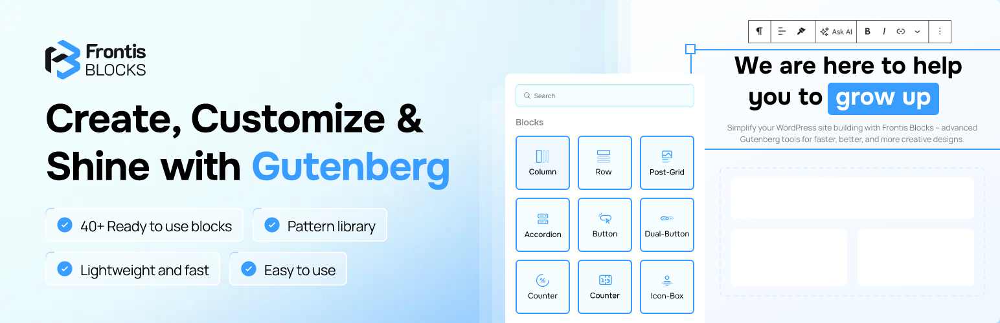

<p align="center">
  <a href="https://github.com/boom-devs/frontis-blocks">
    
  </a>
</p>

<h1 align="center">Frontis Blocks</h1>

<p align="center">
  <strong>Next-Generation Modular Gutenberg Block Library & Design System for WordPress</strong><br>
  Supercharge the WordPress Block Editor with 45+ high-performance blocks, dynamic CSS compiler, form builder, and full-site template cloud.
</p>

<p align="center">
  <a href="https://github.com/boom-devs/frontis-blocks/actions/workflows/ci.yml">
    
  </a>
  
  
  
  <a href="https://github.com/boom-devs/frontis-blocks/blob/main/LICENSE">
    
  </a>
</p>

---

## 📖 Overview

**Frontis Blocks** is a high-performance WordPress Gutenberg plugin powering **30,000+ live websites**. It transforms the default WordPress Block Editor into an intuitive visual site builder without the performance overhead or vendor lock-in of traditional page builders (Elementor, Divi, WPBakery).

All layout, spacing, and responsive design decisions are compiled dynamically into scoped inline CSS via Frontis Blocks' dynamic styling engine, ensuring **zero unused CSS** and industry-leading Core Web Vitals.

---

## ✨ Key Architectural Highlights

- **45+ Custom Gutenberg Blocks**: Sliders, accordions, form builder, coverflow carousel, interactive hotspots, flip boxes, animated headings, tabs, pricing tables, post grids, and timeline builders.
- **35+ Core Design System Controls**: Shared React UI controls in `@Components/*` providing unified responsive typography, color pickers, box-shadows, and spacing controls across all blocks.
- **Zero-Unused-CSS Style Engine**: Dynamic styles are generated via `styling.js` and loaded cleanly on demand — no monolithic CSS stylesheets loaded on pages that don't need them.
- **Native Third-Party Form Integrations**: Built-in visual stylers for Fluent Forms and Contact Form 7.
- **Template Cloud & Full-Site Import**: Integrated cloud template importer for pre-built block patterns and complete website templates.
- **Multi-PHP Certified Matrix**: Automated GitHub Actions testing against **PHP 7.4 through PHP 8.4**.

---

## 🏗️ Repository Architecture

```text
frontis-blocks/
├── admin/                    # Admin dashboard, template library & settings UI
│   ├── components/           # Admin-specific React components
│   ├── dashboard/            # Plugin dashboard & settings UI
│   ├── scss/                 # Admin styles & design tokens
│   └── template-library/     # Cloud template library importer
├── assets/                   # Public assets (icons, fonts, vendor libraries)
├── build/                    # Compiled distribution assets (Webpack output)
├── includes/                 # PHP Backend Architecture
│   ├── Activator/            # Activation & migration hooks
│   ├── Admin/                # WordPress admin menu & settings handlers
│   ├── Core/                 # Core block registration & asset enqueueing
│   ├── Forms/                # Form builder backend & submissions
│   ├── RestApi/              # Custom WP REST API endpoints
│   └── Plugin.php            # Main plugin singleton orchestrator
├── languages/                # Translation POT & PO files
├── src/                      # Source Code
│   ├── blocks/               # 70+ Gutenberg Blocks (accordion, slider, grid, etc.)
│   ├── components/           # 35+ Core Design System Controls (@Components/*)
│   ├── config/               # Block configuration & presets
│   └── utils/                # React hooks, helpers & color utilities
├── .github/                  # GitHub Actions (CI/CD, PR & Issue triage, Gemini review)
└── AGENTS.md                 # Contributor & AI Agent Operational Handbook
```

---

## 💻 Local Development Setup

### Prerequisites

| Requirement | Minimum Version | Recommended |
| :--- | :--- | :--- |
| **Node.js** | `>= 18.0.0` | `20.x LTS` |
| **npm** | `>= 9.0.0` | `10.x` |
| **PHP** | `>= 7.4.0` | `8.2 / 8.3` |
| **WordPress** | `>= 6.0.0` | `6.7+` |

---

### Option A: LocalWP (Recommended GUI Workflow)

1. Open [Local](https://localwp.com/) and create a new WordPress site.
2. Clone this repository directly into the site's plugin directory:
   ```bash
   cd ~/Local\ Sites/<site-name>/app/public/wp-content/plugins/
   git clone https://github.com/boom-devs/frontis-blocks.git
   cd frontis-blocks
   ```
3. Install dependencies and compile initial block assets:
   ```bash
   npm install
   composer install
   npm run build  # Compiles production block bundles into build/
   npm run start  # Starts development watch mode
   ```
4. Activate **Frontis Blocks** from WP Admin → Plugins.

---

### Option B: Docker via `@wordpress/env` (Zero-Config CLI)

```bash
# 1. Clone repository
git clone https://github.com/boom-devs/frontis-blocks.git
cd frontis-blocks

# 2. Install dependencies & build
npm install
composer install
npm run build

# 3. Start WordPress in Docker (Port 8888)
npx @wordpress/env start
```

- **Frontend:** [http://localhost:8888](http://localhost:8888)
- **WP Admin:** [http://localhost:8888/wp-admin](http://localhost:8888/wp-admin) (`Username: admin`, `Password: password`)
- **Stop Environment:** `npx @wordpress/env stop`

---

## ⚡ Essential NPM Scripts

| Command | Purpose |
| :--- | :--- |
| `npm run start` | Watch mode for block development (`wp-scripts start`) |
| `npm run build` | Compiles production assets into `build/` |
| `npm run admin` | Watch mode for admin assets |
| `npm run admin:build` | Compiles admin stylesheets for production |
| `npm run format` | Auto-formats code according to WordPress standards |
| `npm run lint:js` | Runs ESLint across JavaScript files |
| `npm run lint:css` | Runs Stylelint across SCSS stylesheets |
| `npm run zip` | Generates a clean, production-ready WordPress.org distributable zip |

---

## 🛡️ Testing & Continuous Integration

Every pull request runs automated GitHub Actions workflows:
- **Multi-PHP Syntax & Compatibility:** Parallel linting across **PHP 7.4, 8.0, 8.1, 8.2, 8.3, and 8.4**.
- **Block & Admin Build Verification:** Compiles all 70+ block entry points and admin stylesheets with Webpack.
- **Plugin Packaging:** Verifies distributable zip creation (`webpack.zip.js`).
- **Dependency Caching:** Fast CI runs using `actions/cache@v4` for Composer and NPM modules.

---

## 🤝 Contributing & Governance

We welcome contributions from human developers and AI assistants alike! Please review our governance guidelines before submitting pull requests:

- 📖 **[CONTRIBUTING.md](CONTRIBUTING.md)**: Contribution guidelines, branching model, and PR conventions.
- 🤖 **[AGENTS.md](AGENTS.md)**: AI agent & contributor technical operational handbook.
- 📜 **[CODE_OF_CONDUCT.md](CODE_OF_CONDUCT.md)**: Contributor Covenant v2.1 code of conduct.
- 🛡️ **[SECURITY.md](SECURITY.md)**: Vulnerability disclosure and security reporting policy.

> [!IMPORTANT]
> **Issue-Driven Development:** Frontis Blocks strictly requires all pull requests to resolve an approved [GitHub Issue](https://github.com/boom-devs/frontis-blocks/issues) using `Closes #<issue_number>`.

> [!CAUTION]
> **Strict Component Lock Policy (`src/components/`):**
> `src/components/` contains 35+ core UI design system controls shared across **70+ blocks and 30,000+ live websites**.
> 
> - **MAINTAINERS ONLY**: Only repository maintainers (`@noruzzamans`, `@boom-devs`) are authorized to modify, update, or add files in `src/components/`.
> - **NO EXTERNAL EDITS**: External contributors and autonomous AI agents are **strictly forbidden** from editing `src/components/`.
> - **AUTOMATED REJECTION**: Any external pull request modifying `src/components/` will be immediately flagged with `needs: changes` and rejected by CI/CD guards.

---

## 📄 License

Frontis Blocks is open-source software licensed under the **GNU General Public License v2.0 or later (GPL-2.0-or-later)**.

```
Frontis Blocks - Next-Generation Gutenberg Block Library for WordPress
Copyright (C) 2024-2026 BoomDevs

This program is free software; you can redistribute it and/or modify
it under the terms of the GNU General Public License as published by
the Free Software Foundation; either version 2 of the License, or
(at your option) any later version.
```
