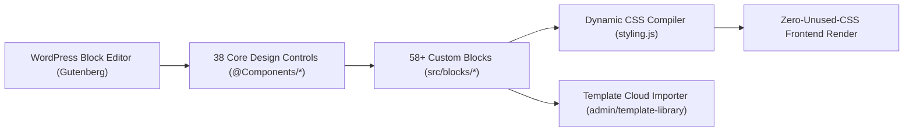

<p align="center">
  <a href="https://github.com/boom-devs/frontis-blocks">
    
  </a>
</p>

<h1 align="center">Frontis Blocks</h1>

<p align="center">
  <strong>⚡ The Enterprise Modular Gutenberg Block Suite & Design System for WordPress</strong><br>
  Supercharge the WordPress Block Editor with 58+ production-ready blocks, 38 design system controls, dynamic zero-unused CSS engine, visual form builder, and cloud template library.
</p>

<p align="center">
  <a href="https://github.com/boom-devs/frontis-blocks/actions/workflows/ci.yml">
    
  </a>
  <a href="https://github.com/boom-devs/frontis-blocks/releases">
    
  </a>
  <a href="https://github.com/boom-devs/frontis-blocks/stargazers">
    
  </a>
  <a href="https://github.com/boom-devs/frontis-blocks/network/members">
    
  </a>
  <a href="https://github.com/boom-devs/frontis-blocks/pulls">
    
  </a>
  <a href="https://wordpress.org/">
    
  </a>
  <a href="https://php.net/">
    
  </a>
  <a href="https://github.com/boom-devs/frontis-blocks/blob/main/LICENSE">
    
  </a>
</p>

<p align="center">
  <a href="#-about--value-proposition">About</a> •
  <a href="#-why-frontis-blocks-comparison">Why Frontis?</a> •
  <a href="#-key-architectural-highlights">Architecture</a> •
  <a href="#-local-development-setup">Setup</a> •
  <a href="#-essential-npm-scripts">Scripts</a> •
  <a href="#-contributing--governance">Contributing</a> •
  <a href="#-support-the-project">Support ⭐</a> •
  <a href="#-contributors">Contributors</a> •
  <a href="#-maintainers--credits">Credits</a> •
  <a href="#-license">License</a>
</p>

---

## 📖 About & Value Proposition

**Frontis Blocks** is a high-performance, modular WordPress Gutenberg plugin and design system. It transforms the core WordPress Block Editor into an intuitive, visual website builder—eliminating the severe performance overhead, code bloat, and proprietary vendor lock-in of traditional page builders like Elementor and Divi.

Every layout, spacing, typography, and responsive decision is compiled dynamically into scoped inline CSS via Frontis Blocks' custom dynamic styling engine. The result: **zero unused CSS**, blazingly fast load times, and flawless Google Core Web Vitals scores right out of the box.

---

## ⚖️ Why Frontis Blocks? (Comparison)

| Feature | Frontis Blocks | Generic Block Addons (Spectra / Kadence) | Traditional Builders (Elementor / Divi) |
| :--- | :---: | :---: | :---: |
| **Gutenberg Native** | ✅ 100% Native Block Canvas | ⚠️ Often bloated wrapper blocks | ❌ Completely proprietary builder iframe |
| **Block Diversity** | ✅ **58+ Blocks** (All Free) | ⚠️ 20–30 Free, rest paywalled behind Pro | ❌ Requires costly annual Pro subscriptions |
| **Design Controls** | ✅ **38 Core Controls** (`@Components/*`) | ⚠️ Fragmented, block-specific settings | ❌ Monolithic proprietary inspector |
| **CSS Delivery Engine** | ✅ **Zero Unused CSS** via dynamic queue | ⚠️ Monolithic global CSS stylesheets | ❌ Heavy CSS/JS runtime loaded sitewide |
| **Form Builder** | ✅ Built-in visual form builder + stylers | ⚠️ Basic contact forms or external plugins | ❌ Bloated form widgets |
| **Core Web Vitals** | ✅ 95+ PageSpeed Scores out-of-the-box | ⚠️ Average (60–80) without optimization | ❌ Poor (DOM inflation, heavy JS payloads) |
| **Licensing & Freedom** | ✅ **GPL-2.0-or-later** (100% Open Source) | ⚠️ Freemium with feature gates | ❌ Strict SaaS licenses & renewal lock-in |

---

## ✨ Key Architectural Highlights



* **58+ Production-Grade Gutenberg Blocks:** Comprehensive coverage spanning containers, sliders, accordions, dynamic query loop builders, multi-column pricing, interactive modals, and forms.
* **38 Unified Core Design System Controls:** Shared React controls located in `src/components/` ensuring 100% consistent typography, responsive spacing, color swatches, box shadows, and icon selectors across all blocks.
* **Zero-Unused-CSS Style Engine:** Dynamic CSS rules are compiled on-demand in `styling.js` and injected directly into the page header. No massive sitewide stylesheets are ever enqueued.
* **Integrated Form Builder:** Design custom interactive lead generation forms with text, textarea, and select dropdown fields, alongside visual stylers for Fluent Forms and Contact Form 7.
* **Cloud Template Library & Full-Site Import:** Instantly import professionally designed block patterns, landing pages, and full website templates directly from the block editor.
* **Certified Multi-PHP CI Matrix:** Every commit is continuously validated against **PHP 7.4, 8.0, 8.1, 8.2, 8.3, and 8.4** in automated GitHub Actions.

---

## 🏗️ Repository Architecture

```text
frontis-blocks/
├── admin/                    # Admin dashboard, template library & settings UI
│   ├── components/           # Admin-specific React components
│   ├── dashboard/            # Plugin dashboard & settings UI
│   ├── scss/                 # Admin styles & design tokens
│   └── template-library/     # Cloud template library importer
├── assets/                   # Public assets (icons, fonts, vendor libraries)
├── build/                    # Compiled distribution assets (Webpack output)
├── includes/                 # PHP Backend Architecture (PSR-4)
│   ├── Activator/            # Activation & migration hooks
│   ├── Admin/                # WordPress admin menu & settings handlers
│   ├── Core/                 # Core block registration & asset enqueueing
│   ├── Forms/                # Form builder backend & submissions
│   ├── RestApi/              # Custom WP REST API endpoints
│   └── Plugin.php            # Main plugin singleton orchestrator
├── languages/                # Translation POT & PO files
├── src/                      # Source Code
│   ├── blocks/               # 58 Gutenberg Blocks (accordion, slider, grid, etc.)
│   ├── components/           # 38 Core Design System Controls (@Components/*)
│   ├── config/               # Block configuration & presets
│   └── utils/                # React hooks, helpers & color utilities
├── .github/                  # GitHub Actions (CI/CD, PR & Issue triage)
├── AGENTS.md                 # Contributor & AI Agent Operational Handbook
├── CONTRIBUTING.md           # Contribution guidelines & Conventional Commits
└── LICENSE                   # GNU General Public License v2.0
```

---

## 💻 Local Development Setup

### Prerequisites

| Requirement | Minimum Version | Recommended |
| :--- | :--- | :--- |
| **Node.js** | `>= 18.0.0` | `20.x LTS` |
| **npm** | `>= 9.0.0` | `10.x` |
| **PHP** | `>= 7.4.0` | `8.2 / 8.3` |
| **WordPress** | `>= 6.0.0` | `6.7+` |

---

### Option A: LocalWP (Recommended GUI Workflow)

1. Open [Local](https://localwp.com/) and create a fresh WordPress site.
2. Clone this repository directly into the site's plugin directory:
   ```bash
   cd ~/Local\ Sites/<site-name>/app/public/wp-content/plugins/
   git clone https://github.com/boom-devs/frontis-blocks.git
   cd frontis-blocks
   ```
3. Install dependencies and compile initial block assets:
   ```bash
   npm install
   composer install
   npm run build  # Compiles production block bundles into build/
   npm run start  # Starts development watch mode
   ```
4. Activate **Frontis Blocks** from **WP Admin → Plugins**.

---

### Option B: Docker via `@wordpress/env` (Zero-Config CLI)

```bash
# 1. Clone repository
git clone https://github.com/boom-devs/frontis-blocks.git
cd frontis-blocks

# 2. Install dependencies & build
npm install
composer install
npm run build

# 3. Start WordPress in Docker (Port 8888)
npx @wordpress/env start
```

* **Frontend:** [http://localhost:8888](http://localhost:8888)
* **WP Admin:** [http://localhost:8888/wp-admin](http://localhost:8888/wp-admin) (`Username: admin`, `Password: password`)
* **Stop Environment:** `npx @wordpress/env stop`

---

## ⚡ Essential NPM Scripts

| Command | Purpose |
| :--- | :--- |
| `npm run start` | Watch mode for block development (`wp-scripts start`) |
| `npm run build` | Compiles production block bundles into `build/` (Webpack 5 filesystem cache enabled) |
| `npm run admin` | Watch mode for admin dashboard and template library assets |
| `npm run admin:build` | Compiles admin stylesheets and React dashboard for production |
| `npm run format` | Auto-formats code according to WordPress coding standards |
| `npm run lint:js` | Runs ESLint across all JavaScript source files |
| `npm run lint:css` | Runs Stylelint across SCSS stylesheets |
| `npm run plugin-zip` | Generates a clean, production-ready distributable archive (`frontis-blocks.zip`) |

---

## 🛡️ Testing & Continuous Integration

Every pull request runs automated GitHub Actions workflows:
* **Multi-PHP Syntax & Compatibility:** Parallel linting across **PHP 7.4, 8.0, 8.1, 8.2, 8.3, and 8.4**.
* **Block & Admin Build Verification:** Compiles all 58+ block entry points and admin stylesheets with Webpack 5.
* **Webpack 5 Persistent Cache:** Fast CI builds powered by persistent filesystem caching (`.cache/webpack`).
* **Packaging & Archive Audit:** Verifies distributable zip creation (`webpack.zip.js`) with zero missing dependencies.
* **Dependency Caching:** Instant CI runs using `actions/cache@v4` for Composer and NPM modules.

---

## 🤝 Contributing & Governance

We welcome contributions from developers, designers, and documentation writers! Please review our governance guidelines before submitting pull requests:

* 📖 **[CONTRIBUTING.md](CONTRIBUTING.md)**: Contribution workflow, Conventional Commits, and PR conventions.
* 🤖 **[AGENTS.md](AGENTS.md)**: AI agent & contributor technical operational handbook.
* 📜 **[CODE_OF_CONDUCT.md](CODE_OF_CONDUCT.md)**: Contributor Covenant v2.1 code of conduct.
* 🛡️ **[SECURITY.md](SECURITY.md)**: Vulnerability disclosure and security reporting policy.

> [!IMPORTANT]
> **Issue-Driven Development:** All pull requests must resolve an approved [GitHub Issue](https://github.com/boom-devs/frontis-blocks/issues) using `Closes #<issue_number>`.

> [!CAUTION]
> **Strict Component Lock Policy (`src/components/`):**
> `src/components/` contains 38 core UI design system controls shared across **58+ blocks**.
> 
> * **MAINTAINERS ONLY**: Only repository maintainers (`@noruzzamans`, `@boom-devs`) are authorized to modify, refactor, or add files in `src/components/`.
> * **NO EXTERNAL EDITS**: External contributors and autonomous AI agents are **strictly forbidden** from editing `src/components/`.
> * **AUTOMATED REJECTION**: Any external pull request touching `src/components/` will be immediately flagged with `needs: changes` and rejected by CI/CD guards.

---

---

## ⭐ Support the Project

If you find **Frontis Blocks** valuable or use it in your projects, please consider giving it a star on GitHub! It takes just a second and helps the project gain visibility across the WordPress & open-source community, attract more contributors, and motivates ongoing active development.

<p align="center">
  <a href="https://github.com/boom-devs/frontis-blocks">
    
  </a>
</p>

- **Star this repository** to bookmark it for future use.
- **Share it** with fellow WordPress developers, agencies, and friends.
- **Contribute** code, docs, or ideas to our open [Issues](https://github.com/boom-devs/frontis-blocks/issues).

---

<a id="contributors"></a>
## 👥 Contributors

Thank you to all the amazing people who contribute to Frontis Blocks!

<p align="center">
  <a href="https://github.com/EnamulHaq">
    
  </a>
  <a href="https://github.com/noruzzamans">
    
  </a>
  <a href="https://github.com/Mehedi2509">
    
  </a>
  <a href="https://github.com/ashrafulislamsaon">
    
  </a>
  <a href="https://github.com/shagib">
    
  </a>
  <a href="https://github.com/MD-ANIKS">
    
  </a>
  <a href="https://github.com/Shiddik">
    
  </a>
  <a href="https://github.com/sheikhshartho">
    
  </a>
  <a href="https://github.com/ikamal7">
    
  </a>
  <a href="https://github.com/tarekhossain0043-dot">
    
  </a>
  <a href="https://github.com/Muttakin96">
    
  </a>
  <a href="https://github.com/irfat-ifti">
    
  </a>
  <a href="https://github.com/alihasandeveloper">
    
  </a>
  <a href="https://github.com/Mehedi-42">
    
  </a>
</p>

Contributions of any kind are welcome! See our [Contributing Guide](CONTRIBUTING.md) to get started.

---

## 👨‍💻 Maintainers & Credits

<table width="100%">
  <tbody>
    <tr>
      <td align="center" width="50%" valign="top">
        <br>
        <a href="https://github.com/EnamulHaq">
          
        </a>
        <br><br>
        <h3 align="center">Md. Enamul Haq</h3>
        <p align="center">
          <strong>WordPress & PHP Backend Engineer</strong><br>
          Core Architecture & Systems Engineering
        </p>
        <p align="center">
          <a href="https://github.com/EnamulHaq" title="GitHub">
            
          </a>
          <a href="https://profiles.wordpress.org/enamulhaq/" title="WordPress.org Profile">
            
          </a>
        </p>
        <br>
        
      </td>
      <td align="center" width="50%" valign="top">
        <br>
        <a href="https://github.com/noruzzamans">
          
        </a>
        <br><br>
        <h3 align="center">Md. Noruzzaman</h3>
        <p align="center">
          <strong>Senior WordPress Systems & Core Engineer</strong><br>
          WordPress 7.2 Release Squad (Test Lead) · Core Contributor (6.6–7.2)
        </p>
        <p align="center">
          <a href="https://github.com/noruzzamans" title="GitHub">
            
          </a>
          <a href="https://linkedin.com/in/noruzzaman" title="LinkedIn">
            
          </a>
          <a href="https://x.com/Noruzzamanwp" title="X (Twitter)">
            
          </a>
          <a href="https://profiles.wordpress.org/noruzzaman/" title="WordPress.org Profile">
            
          </a>
        </p>
        <br>
        
      </td>
    </tr>
  </tbody>
</table>

<p align="center">
  <a href="https://github.com/boom-devs" title="BoomDevs Organization">
    
  </a>
</p>

### Special Credits
- [WordPress Gutenberg](https://github.com/WordPress/gutenberg) — Block editor framework.
- [React](https://reactjs.org/) — Declarative UI component engine.
- [Swiper.js](https://swiperjs.com/) — High-performance modern touch slider library.
- [Lottie](https://airbnb.io/lottie/) & [Rive](https://rive.app/) — Next-generation vector animation engines.
- [Appsero](https://appsero.com/) — Telemetry and plugin analytics.

---

## 📄 License

Frontis Blocks is open-source software licensed under the **GNU General Public License v2.0 or later (GPL-2.0-or-later)**.

```text
Frontis Blocks - Next-Generation Gutenberg Block Library for WordPress
Copyright (C) 2024-2026 BoomDevs

This program is free software; you can redistribute it and/or modify
it under the terms of the GNU General Public License as published by
the Free Software Foundation; either version 2 of the License, or
(at your option) any later version.
```
